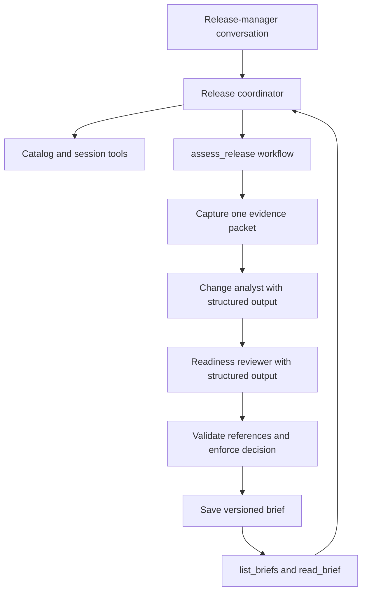

# Architecture

Launch Room separates source facts, deterministic readiness rules, specialist interpretation, and generated artifacts.

## Domain layer

- `data/releases.json` owns versioned release records and evidence.
- `agent/lib/contracts.ts` owns runtime Zod schemas and inferred TypeScript types.
- `catalog.ts` validates the catalog and supplies release summaries and isolated release records.
- `readiness.ts` computes required-check, change-validation, and dependency gates.
- `briefs.ts` checks specialist references, enforces decision precedence, and renders the brief.
- `brief-store.ts` lists and reads saved briefs and atomically publishes complete JSON files in `var/briefs/`.

The catalog is read-only at runtime. A brief does not mutate source evidence. Its timestamp means when that catalog snapshot was captured, not when production was inspected.

## Durable assessment

`agent/tools/assess_release.ts` is an Eve workflow tool. Its workflow body captures evidence in a step, validates the exact input object sent to each specialist, awaits the change analyst's result, validates it, and then awaits the readiness review. Each child receives an explicit JSON payload and an attached output schema. Incomplete turns and invalid output stop the workflow.

The workflow uses helpers in `agent/lib/assessment.ts` for steps that read the clock, validate results, and persist artifacts. Clock, hashing, and filesystem operations stay outside the replayed workflow body. Specialist results cite only IDs present in the captured packet.

A saved brief ID is the SHA-256 of release ID and workflow call ID. Repeating the same persistence step returns the existing brief. A new workflow call creates a new ID. Writes use a temporary file and rename so readers see a complete JSON document. The store belongs to the local instance and is not a shared hosted database.

## Session and runtime

The root's named Eve state retains only the selected release ID across turns. A dynamic system instruction exposes that focus. The workflow accepts an explicit release ID and does not read session state from its steps. Specialists do not inherit parent state or conversation.

Static system instructions derive from complete canonical agent instructions plus selected context through `?raw` imports. Eve compiles those strings into its runtime artifacts. Canonical edits require a rebuild or development reload. See [runtime guidance](../moldea/runtimes/eve.md) for the complete connection trace.

The application uses Eve's default conversation/HTTP channel and local runtime storage. It defines no external connections or deployment actions.
